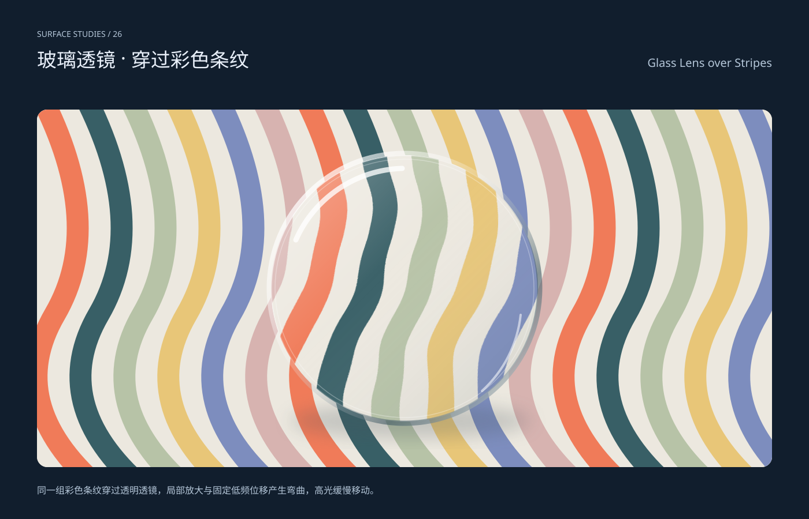

# 玻璃透镜 · 穿过彩色条纹 / Glass Lens over Stripes

分类：[背景与材质](../_about.md)



```
用SVG绘制“玻璃透镜 · 穿过彩色条纹 / Glass Lens over Stripes”。
- 展示画幅1400×900，外框#111e2d，文字#e9f0fa/辅助#b5c7d9；中英文名称与页脚在纹理区外，样张x64..1336、y190..810。
- 同一组彩色条纹穿过透明透镜，局部放大与固定低频位移产生弯曲，高光缓慢移动。
- stripe-scene两次use；透镜内部先铺不透明底遮住清晰原图，再以中心(700,500)的1.18倍变换复用底图；translate(-126,-90)使中心固定，镜内裁切半径231。
- 固定seed29、frequency(.006,.012)、单层噪声仅作32px位移；不是物理光线追踪或浏览器backdrop-filter，无法折射外部网页。圆形边缘、阴影与渐变高光支持静态画面，只有上缘高光10秒轻移(5,7)和透明度缓变；滤镜失效时仍有局部放大。
- 材质为矢量视觉模拟，不宣称物理渲染、材料性能或真实测量。背景使用时提取样张组并同步保留其defs，移除外框标题；只有pattern作品可以按单元无缝平铺，其余为固定构图。
- 动效只用于装饰，8–10秒缓变，无闪烁和主体遮挡；减少动效禁用CSS动画，静态基底完整；滤镜不支持时质感会简化。
- 生成器scripts/build-backgrounds.py记录构造，完整SVG参考：
<svg xmlns="http://www.w3.org/2000/svg" width="1400" height="900" viewBox="0 0 1400 900" role="img" aria-labelledby="title desc" font-family="PingFang SC, Microsoft YaHei, sans-serif"><title id="title">玻璃透镜 · 穿过彩色条纹 / Glass Lens over Stripes</title><desc id="desc">同一组彩色条纹穿过透明透镜，局部放大与固定低频位移产生弯曲，高光缓慢移动。；stripe-scene两次use；透镜内部先铺不透明底遮住清晰原图，再以中心(700,500)的1.18倍变换复用底图；translate(-126,-90)使中心固定，镜内裁切半径231。；固定seed29、frequency(.006,.012)、单层噪声仅作32px位移；不是物理光线追踪或浏览器backdrop-filter，无法折射外部网页。圆形边缘、阴影与渐变高光支持静态画面，只有上缘高光10秒轻移(5,7)和透明度缓变；滤镜失效时仍有局部放大。</desc><rect x="0" y="0" width="1400" height="900" fill="#111e2d" /><text x="64" y="64" font-size="14" fill="#b5c7d9" text-anchor="start">SURFACE STUDIES / 26</text><text x="64" y="116" font-size="34" fill="#e9f0fa" text-anchor="start">玻璃透镜 · 穿过彩色条纹</text><text x="1336" y="116" font-size="20" fill="#b5c7d9" text-anchor="end">Glass Lens over Stripes</text><defs><clipPath id="stage"><rect x="64" y="190" width="1272" height="620" rx="18"/></clipPath></defs><g clip-path="url(#stage)"><rect x="64" y="190" width="1272" height="620" fill="#ece8df" /><defs><g id="stripe-scene"><rect x="64" y="190" width="1272" height="620" fill="#ece8df"/><path d="M70 165Q185 390 95 545T170 845" fill="none" stroke="#f07b59" stroke-width="38" stroke-linecap="round" stroke-linejoin="round" /><path d="M146 165Q261 390 171 545T246 845" fill="none" stroke="#385f66" stroke-width="38" stroke-linecap="round" stroke-linejoin="round" /><path d="M222 165Q337 390 247 545T322 845" fill="none" stroke="#b7c3a7" stroke-width="38" stroke-linecap="round" stroke-linejoin="round" /><path d="M298 165Q413 390 323 545T398 845" fill="none" stroke="#e8c678" stroke-width="38" stroke-linecap="round" stroke-linejoin="round" /><path d="M374 165Q489 390 399 545T474 845" fill="none" stroke="#7d8dbe" stroke-width="38" stroke-linecap="round" stroke-linejoin="round" /><path d="M450 165Q565 390 475 545T550 845" fill="none" stroke="#d7b3b0" stroke-width="38" stroke-linecap="round" stroke-linejoin="round" /><path d="M526 165Q641 390 551 545T626 845" fill="none" stroke="#f07b59" stroke-width="38" stroke-linecap="round" stroke-linejoin="round" /><path d="M602 165Q717 390 627 545T702 845" fill="none" stroke="#385f66" stroke-width="38" stroke-linecap="round" stroke-linejoin="round" /><path d="M678 165Q793 390 703 545T778 845" fill="none" stroke="#b7c3a7" stroke-width="38" stroke-linecap="round" stroke-linejoin="round" /><path d="M754 165Q869 390 779 545T854 845" fill="none" stroke="#e8c678" stroke-width="38" stroke-linecap="round" stroke-linejoin="round" /><path d="M830 165Q945 390 855 545T930 845" fill="none" stroke="#7d8dbe" stroke-width="38" stroke-linecap="round" stroke-linejoin="round" /><path d="M906 165Q1021 390 931 545T1006 845" fill="none" stroke="#d7b3b0" stroke-width="38" stroke-linecap="round" stroke-linejoin="round" /><path d="M982 165Q1097 390 1007 545T1082 845" fill="none" stroke="#f07b59" stroke-width="38" stroke-linecap="round" stroke-linejoin="round" /><path d="M1058 165Q1173 390 1083 545T1158 845" fill="none" stroke="#385f66" stroke-width="38" stroke-linecap="round" stroke-linejoin="round" /><path d="M1134 165Q1249 390 1159 545T1234 845" fill="none" stroke="#b7c3a7" stroke-width="38" stroke-linecap="round" stroke-linejoin="round" /><path d="M1210 165Q1325 390 1235 545T1310 845" fill="none" stroke="#e8c678" stroke-width="38" stroke-linecap="round" stroke-linejoin="round" /><path d="M1286 165Q1401 390 1311 545T1386 845" fill="none" stroke="#7d8dbe" stroke-width="38" stroke-linecap="round" stroke-linejoin="round" /><path d="M1362 165Q1477 390 1387 545T1462 845" fill="none" stroke="#d7b3b0" stroke-width="38" stroke-linecap="round" stroke-linejoin="round" /></g><clipPath id="lens-clip"><circle cx="700" cy="500" r="231"/></clipPath><filter id="lens-warp" x="-20%" y="-20%" width="140%" height="140%" color-interpolation-filters="sRGB"><feTurbulence type="fractalNoise" baseFrequency=".006 .012" numOctaves="1" seed="29" result="ripple"/><feDisplacementMap in="SourceGraphic" in2="ripple" scale="32" xChannelSelector="R" yChannelSelector="G"/></filter><filter id="lens-shadow" x="-30%" y="-30%" width="160%" height="160%"><feGaussianBlur stdDeviation="15"/></filter><linearGradient id="lens-tint" x1="0" y1="0" x2="1" y2="1"><stop stop-color="#fff" stop-opacity=".36"/><stop offset=".42" stop-color="#fff" stop-opacity=".02"/><stop offset="1" stop-color="#4f6064" stop-opacity=".18"/></linearGradient><linearGradient id="lens-rim" x1="0" y1="0" x2="1" y2="1"><stop stop-color="#fff"/><stop offset=".42" stop-color="#fff" stop-opacity=".18"/><stop offset=".72" stop-color="#405963" stop-opacity=".6"/><stop offset="1" stop-color="#fff" stop-opacity=".85"/></linearGradient></defs><use href="#stripe-scene"/><ellipse cx="710" cy="730" rx="208" ry="30" fill="#44535c" opacity=".24" filter="url(#lens-shadow)"/><g clip-path="url(#lens-clip)" data-lens-interior="true"><rect x="460" y="260" width="480" height="480" fill="#ece8df"/><use href="#stripe-scene" transform="translate(-126 -90) scale(1.18)" filter="url(#lens-warp)"/><circle cx="700" cy="500" r="231" fill="url(#lens-tint)"/></g><circle cx="700.000" cy="500.000" r="234.000" fill="none" stroke="url(#lens-rim)" stroke-width="9"/><circle cx="700.000" cy="500.000" r="224.000" fill="none" stroke="white" stroke-opacity=".3" stroke-width="1.5"/><path d="M512 416A208 208 0 0 1 696 292" fill="none" stroke="#fff" stroke-width="9" stroke-linecap="round" stroke-linejoin="round" opacity=".78" class="lens-glint"/><path d="M834 678A208 208 0 0 0 901 546" fill="none" stroke="#fff" stroke-width="4" stroke-linecap="round" stroke-linejoin="round" opacity=".55"/><style>@keyframes lens-light{50%{transform:translate(5px,7px);opacity:.48}}.lens-glint{animation:lens-light 10s ease-in-out infinite}@media(prefers-reduced-motion:reduce){.lens-glint{animation:none}}</style></g><text x="64" y="856" font-size="16" fill="#b5c7d9" text-anchor="start">同一组彩色条纹穿过透明透镜，局部放大与固定低频位移产生弯曲，高光缓慢移动。</text><style>@keyframes drift{50%{transform:translate(0,12px)}}@keyframes shine{50%{opacity:.75}}.drift{animation:drift 10s ease-in-out infinite}.shine{animation:shine 8s ease-in-out infinite}@media(prefers-reduced-motion:reduce){.drift,.shine{animation:none}}</style></svg>
```
