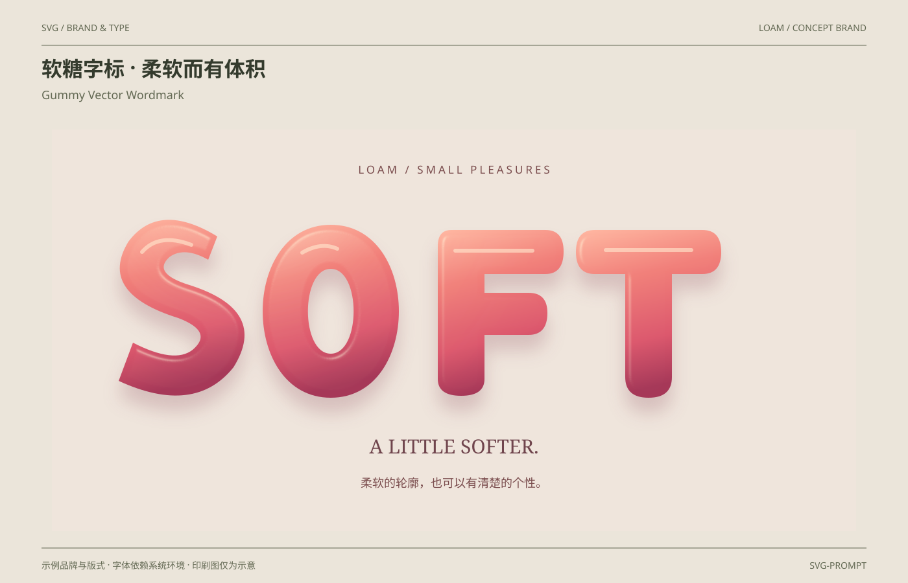

# 软糖字标 · 柔软而有体积 / Gummy Vector Wordmark

分类：[品牌与排版](../_about.md)



```
用 SVG 制作“软糖字标 · 柔软而有体积 / Gummy Vector Wordmark”，采用LOAM示例品牌。
- 画布1400×900；背景#ebe5da、纸面#faf5e9、正文#343b2d、辅助文字#626852、强调色#94583b；顶部中英文标题，作品区域x64..1336、y200..820，页脚说明示例与印刷边界。
- LOAM概念系列的SOFT软糖字标；四个字母均为自绘闭合矢量路径，暖粉到莓红渐变、接触阴影与表面高光建立柔软体积，不依赖字体生成字标。
- 共享soft-glyphs三次use：偏移24px模糊阴影、清晰渐变主体、SourceAlpha模糊生成bump的feSpecularLighting；feComposite将高光裁回字形，不让高光替代可读主体。
- 高光透明度在基础0.6与0.38间8秒缓变，字形和位置不动；无真实材料折射、物理光照与可食用产品宣称。
- NOVA共用标准矢量标识：6×6单位视图，路径 M0 0 L2 0 L6 4 L6 6 L4 6 L0 2 Z M4 0 L6 0 L6 2 Z M0 4 L0 6 L2 6 Z；字标N/O/V/A共用固定矢量轮廓，宽高266:60；不依赖字体重建字标。
- 其他标题采用系统无衬线或Georgia衬线回退；中英文字体由环境决定，不声称嵌入商业字体。
- 文字和样例值：["SVG / BRAND & TYPE", "LOAM / CONCEPT BRAND", "软糖字标 · 柔软而有体积", "Gummy Vector Wordmark", "示例品牌与版式 · 字体依赖系统环境 · 印刷图仅为示意", "SVG-PROMPT", "LOAM / SMALL PLEASURES", "A LITTLE SOFTER.", "柔软的轮廓，也可以有清楚的个性。"]。
- CSS仅点缀装饰层，基础SVG属性就是完整静态构图；减少动效禁用动画，正文与品牌名始终可见；不依赖脚本或外部字体与图片。
- 完整SVG几何、颜色和动效参考：
<svg xmlns="http://www.w3.org/2000/svg" width="1400" height="900" viewBox="0 0 1400 900" font-family="PingFang SC, Microsoft YaHei, sans-serif" role="img" aria-labelledby="title desc"><title id="title">软糖字标 · 柔软而有体积</title><desc id="desc">LOAM概念系列的SOFT软糖字标；四个字母均为自绘闭合矢量路径，暖粉到莓红渐变、接触阴影与表面高光建立柔软体积，不依赖字体生成字标。</desc><rect x="0.000" y="0.000" width="1400.000" height="900.000" fill="#ebe5da" rx="0" /><text x="64.000" y="48.000" font-size="14" fill="#626852" text-anchor="start" font-weight="400" >SVG / BRAND &amp; TYPE</text><text x="1336.000" y="48.000" font-size="14" fill="#626852" text-anchor="end" font-weight="400" >LOAM / CONCEPT BRAND</text><line x1="64.000" y1="70.000" x2="1336.000" y2="70.000" stroke="#626852" stroke-width="1" /><text x="64.000" y="118.000" font-size="32" fill="#343b2d" text-anchor="start" font-weight="700" >软糖字标 · 柔软而有体积</text><text x="64.000" y="153.000" font-size="18" fill="#626852" text-anchor="start" font-weight="400" >Gummy Vector Wordmark</text><line x1="64.000" y1="846.000" x2="1336.000" y2="846.000" stroke="#626852" stroke-width="1" /><text x="64.000" y="878.000" font-size="14" fill="#626852" text-anchor="start" font-weight="400" >示例品牌与版式 · 字体依赖系统环境 · 印刷图仅为示意</text><text x="1336.000" y="878.000" font-size="14" fill="#626852" text-anchor="end" font-weight="400" >SVG-PROMPT</text><defs><symbol id="nova-mark" viewBox="0 0 6 6"><path d="M0 0 L2 0 L6 4 L6 6 L4 6 L0 2 Z M4 0 L6 0 L6 2 Z M0 4 L0 6 L2 6 Z"/></symbol><symbol id="nova-wordmark" viewBox="0 0 266 60"><path d="M0 0 H12 L42 38 V0 H54 V60 H42 L12 22 V60 H0 Z" transform="translate(0 0)" fill-rule="evenodd"/><path d="M12 0 H44 L56 12 V48 L44 60 H12 L0 48 V12 Z M17 12 L12 17 V43 L17 48 H39 L44 43 V17 L39 12 Z" transform="translate(66 0)" fill-rule="evenodd"/><path d="M0 0 H14 L30 43 L46 0 H60 L38 60 H22 Z" transform="translate(134 0)" fill-rule="evenodd"/><path d="M0 60 L22 0 H38 L60 60 H45 L40 45 H20 L15 60 Z M26 30 H34 L30 17 Z" transform="translate(206 0)" fill-rule="evenodd"/></symbol></defs><rect x="80.000" y="200.000" width="1240.000" height="620.000" fill="#efe5dc" rx="0" /><defs><linearGradient id="gummy-color" x1="0" y1="0" x2=".2" y2="1"><stop stop-color="#ffb8a2"/><stop offset=".34" stop-color="#f17f79"/><stop offset=".72" stop-color="#dc586d"/><stop offset="1" stop-color="#a63858"/></linearGradient><filter id="gummy-shadow" x="-30%" y="-50%" width="160%" height="200%"><feGaussianBlur stdDeviation="14"/></filter><filter id="gummy-light" x="-12%" y="-25%" width="124%" height="150%" color-interpolation-filters="sRGB"><feGaussianBlur in="SourceAlpha" stdDeviation="5" result="bump"/><feSpecularLighting in="bump" surfaceScale="12" specularConstant=".8" specularExponent="22" lighting-color="#fff4da" result="spec"><fePointLight x="390" y="250" z="220"/></feSpecularLighting><feComposite in="spec" in2="SourceAlpha" operator="in"/></filter><g id="soft-glyphs" fill-rule="evenodd"><path d="M335 365Q245 310 198 373Q150 452 275 491Q330 512 297 540Q269 562 205 529L183 588Q300 642 360 567Q415 479 292 440Q234 422 261 397Q284 380 321 401Z"/><path d="M510 347C370 347 370 614 510 614C650 614 650 347 510 347Z M510 415C557 415 557 546 510 546C463 546 463 415 510 415Z"/><path d="M696 355Q675 355 675 380V585Q675 611 711 611Q747 611 747 585V517H815Q844 517 844 483Q844 452 815 452H747V423H841Q869 423 869 388Q869 355 841 355Z"/><path d="M917 355Q888 355 888 389Q888 423 917 423H964V582Q964 614 1000 614Q1036 614 1036 582V423H1083Q1112 423 1112 389Q1112 355 1083 355Z"/></g></defs><text x="700.000" y="268.000" font-size="17" fill="#794b4c" text-anchor="middle" font-weight="400" letter-spacing="4">LOAM / SMALL PLEASURES</text><use href="#soft-glyphs" fill="#833e51" opacity=".23" transform="translate(0 24)" filter="url(#gummy-shadow)"/><use href="#soft-glyphs" fill="url(#gummy-color)"/><use href="#soft-glyphs" fill="#fff" filter="url(#gummy-light)" opacity=".6" class="gummy-glint"/><path d="M219 389Q245 359 295 378M466 390Q495 373 520 384M702 387H821M934 386H1066" fill="none" stroke="#ffe3cb" stroke-width="6" opacity=".65" stroke-linecap="round"/><text x="700.000" y="700.000" font-size="30" fill="#70454d" text-anchor="middle" font-weight="400" font-family="Georgia, serif" >A LITTLE SOFTER.</text><text x="700.000" y="752.000" font-size="18" fill="#794b4c" text-anchor="middle" font-weight="400" >柔软的轮廓，也可以有清楚的个性。</text><style>@keyframes gummy-shine{50%{opacity:.38}}.gummy-glint{animation:gummy-shine 8s ease-in-out infinite}@media(prefers-reduced-motion:reduce){.gummy-glint{animation:none}}</style></svg>

```
