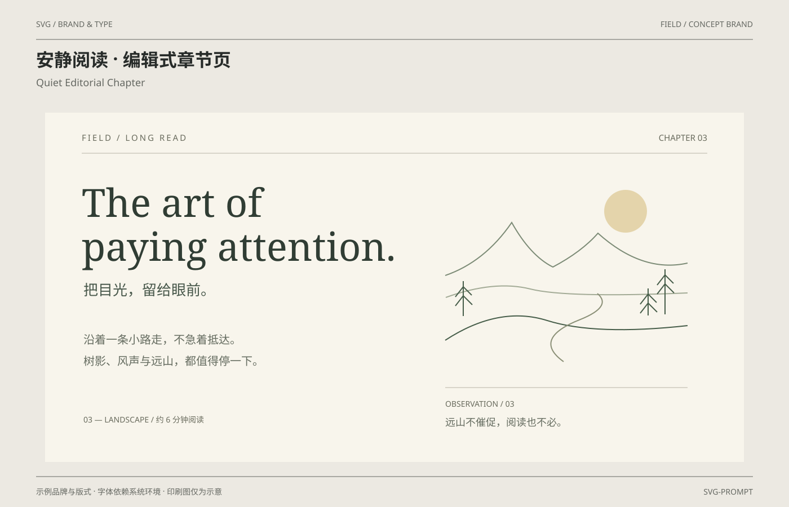

# 安静阅读 · 编辑式章节页 / Quiet Editorial Chapter

分类：[品牌与排版](../_about.md)



```
用 SVG 制作“安静阅读 · 编辑式章节页 / Quiet Editorial Chapter”，采用FIELD示例品牌。
- 画布1400×900；背景#ece9e2、纸面#faf8f1、正文#272b29、辅助文字#656862、强调色#b23c32；顶部中英文标题，作品区域x64..1336、y200..820，页脚说明示例与印刷边界。
- FIELD虚构长文第三章阅读扉页；米白留白、Georgia衬线标题、中文导语、右侧线描风景形成主次，阅读时长约6分钟为虚构示例。
- 所有正文首帧完整；仅风景mask内白色矩形宽度从110px扩至440px，2.8秒一次揭示后停住；基础width440，CSS失效与减少动效均显示完整风景。
- NOVA共用标准矢量标识：6×6单位视图，路径 M0 0 L2 0 L6 4 L6 6 L4 6 L0 2 Z M4 0 L6 0 L6 2 Z M0 4 L0 6 L2 6 Z；字标N/O/V/A共用固定矢量轮廓，宽高266:60；不依赖字体重建字标。
- 其他标题采用系统无衬线或Georgia衬线回退；中英文字体由环境决定，不声称嵌入商业字体。
- 文字和样例值：["SVG / BRAND & TYPE", "FIELD / CONCEPT BRAND", "安静阅读 · 编辑式章节页", "Quiet Editorial Chapter", "示例品牌与版式 · 字体依赖系统环境 · 印刷图仅为示意", "SVG-PROMPT", "FIELD / LONG READ", "CHAPTER 03", "The art of", "paying attention.", "把目光，留给眼前。", "沿着一条小路走，不急着抵达。", "树影、风声与远山，都值得停一下。", "03 — LANDSCAPE / 约 6 分钟阅读", "OBSERVATION  /  03", "远山不催促，阅读也不必。"]。
- CSS仅点缀装饰层，基础SVG属性就是完整静态构图；减少动效禁用动画，正文与品牌名始终可见；不依赖脚本或外部字体与图片。
- 完整SVG几何、颜色和动效参考：
<svg xmlns="http://www.w3.org/2000/svg" width="1400" height="900" viewBox="0 0 1400 900" font-family="PingFang SC, Microsoft YaHei, sans-serif" role="img" aria-labelledby="title desc"><title id="title">安静阅读 · 编辑式章节页</title><desc id="desc">FIELD虚构长文第三章阅读扉页；米白留白、Georgia衬线标题、中文导语、右侧线描风景形成主次，阅读时长约6分钟为虚构示例。</desc><rect x="0.000" y="0.000" width="1400.000" height="900.000" fill="#ece9e2" rx="0" /><text x="64.000" y="48.000" font-size="14" fill="#656862" text-anchor="start" font-weight="400" >SVG / BRAND &amp; TYPE</text><text x="1336.000" y="48.000" font-size="14" fill="#656862" text-anchor="end" font-weight="400" >FIELD / CONCEPT BRAND</text><line x1="64.000" y1="70.000" x2="1336.000" y2="70.000" stroke="#656862" stroke-width="1" /><text x="64.000" y="118.000" font-size="32" fill="#272b29" text-anchor="start" font-weight="700" >安静阅读 · 编辑式章节页</text><text x="64.000" y="153.000" font-size="18" fill="#656862" text-anchor="start" font-weight="400" >Quiet Editorial Chapter</text><line x1="64.000" y1="846.000" x2="1336.000" y2="846.000" stroke="#656862" stroke-width="1" /><text x="64.000" y="878.000" font-size="14" fill="#656862" text-anchor="start" font-weight="400" >示例品牌与版式 · 字体依赖系统环境 · 印刷图仅为示意</text><text x="1336.000" y="878.000" font-size="14" fill="#656862" text-anchor="end" font-weight="400" >SVG-PROMPT</text><defs><symbol id="nova-mark" viewBox="0 0 6 6"><path d="M0 0 L2 0 L6 4 L6 6 L4 6 L0 2 Z M4 0 L6 0 L6 2 Z M0 4 L0 6 L2 6 Z"/></symbol><symbol id="nova-wordmark" viewBox="0 0 266 60"><path d="M0 0 H12 L42 38 V0 H54 V60 H42 L12 22 V60 H0 Z" transform="translate(0 0)" fill-rule="evenodd"/><path d="M12 0 H44 L56 12 V48 L44 60 H12 L0 48 V12 Z M17 12 L12 17 V43 L17 48 H39 L44 43 V17 L39 12 Z" transform="translate(66 0)" fill-rule="evenodd"/><path d="M0 0 H14 L30 43 L46 0 H60 L38 60 H22 Z" transform="translate(134 0)" fill-rule="evenodd"/><path d="M0 60 L22 0 H38 L60 60 H45 L40 45 H20 L15 60 Z M26 30 H34 L30 17 Z" transform="translate(206 0)" fill-rule="evenodd"/></symbol></defs><rect x="80.000" y="200.000" width="1240.000" height="620.000" fill="#f8f5ec" rx="0" /><line x1="145.000" y1="272.000" x2="1255.000" y2="272.000" stroke="#b7b3a6" stroke-width="1" /><text x="145.000" y="250.000" font-size="15" fill="#696b5d" text-anchor="start" font-weight="400" letter-spacing="3">FIELD / LONG READ</text><text x="1255.000" y="250.000" font-size="15" fill="#696b5d" text-anchor="end" font-weight="400" >CHAPTER 03</text><text x="145.000" y="385.000" font-size="69" fill="#303d34" text-anchor="start" font-weight="400" font-family="Georgia, serif" >The art of</text><text x="145.000" y="463.000" font-size="69" fill="#303d34" text-anchor="start" font-weight="400" font-family="Georgia, serif" >paying attention.</text><text x="148.000" y="524.000" font-size="26" fill="#48584b" text-anchor="start" font-weight="400" >把目光，留给眼前。</text><text x="148.000" y="610.000" font-size="20" fill="#656c60" text-anchor="start" font-weight="400" >沿着一条小路走，不急着抵达。</text><text x="148.000" y="648.000" font-size="20" fill="#656c60" text-anchor="start" font-weight="400" >树影、风声与远山，都值得停一下。</text><text x="148.000" y="750.000" font-size="14" fill="#696b5d" text-anchor="start" font-weight="400" >03 — LANDSCAPE / 约 6 分钟阅读</text><defs><mask id="landscape-reveal" maskUnits="userSpaceOnUse" x="785" y="310" width="440" height="355"><rect x="785" y="310" width="440" height="355" fill="white" class="chapter-mask"/></mask></defs><g mask="url(#landscape-reveal)"><circle cx="1110" cy="375" r="38" fill="#e4d4ab" /><path d="M790 489Q860 465 908 395Q941 454 981 474Q1032 447 1061 414Q1140 485 1220 467" fill="none" stroke="#7c8b76" stroke-width="2" /><path d="M791 528Q877 497 941 513T1220 520" fill="none" stroke="#a3ab96" stroke-width="2" /><path d="M790 604Q885 542 971 569T1220 578" fill="none" stroke="#465d49" stroke-width="2" /><path d="M1000 642Q943 601 1030 567Q1087 544 1060 521" fill="none" stroke="#8a8f76" stroke-width="2" /><path d="M822 561v-62m-14 28 14-18 15 15m-29 19 14-18 16 16" fill="none" stroke="#465d49" stroke-width="2" /><path d="M1180 558v-80m-14 28 14-18 15 15m-29 19 14-18 16 16" fill="none" stroke="#465d49" stroke-width="2" /><path d="M1150 560v-48m-14 28 14-18 15 15m-29 19 14-18 16 16" fill="none" stroke="#465d49" stroke-width="2" /></g><line x1="790.000" y1="688.000" x2="1220.000" y2="688.000" stroke="#b7b3a6" stroke-width="1" /><text x="790.000" y="722.000" font-size="14" fill="#696b5d" text-anchor="start" font-weight="400" >OBSERVATION  /  03</text><text x="790.000" y="756.000" font-size="18" fill="#656c60" text-anchor="start" font-weight="400" >远山不催促，阅读也不必。</text><style>@keyframes chapter-open{from{width:110px}to{width:440px}}.chapter-mask{animation:chapter-open 2.8s cubic-bezier(.2,.6,.3,1) 1}@media(prefers-reduced-motion:reduce){.chapter-mask{animation:none}}</style></svg>

```
