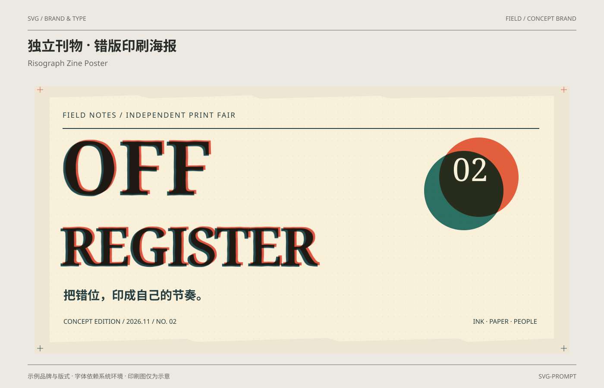

# 独立刊物 · 错版印刷海报 / Risograph Zine Poster

分类：[品牌与排版](../_about.md)



```
用 SVG 制作“独立刊物 · 错版印刷海报 / Risograph Zine Poster”，采用FIELD示例品牌。
- 画布1400×900；背景#ece9e2、纸面#faf8f1、正文#272b29、辅助文字#656862、强调色#b23c32；顶部中英文标题，作品区域x64..1336、y200..820，页脚说明示例与印刷边界。
- FIELD虚构独立刊物印刷展海报；暖纸、深青与朱红套印、撕纸边缘及大标题构成完整活动版式，非真实活动公告。
- OFF / REGISTER两层文字几何相同；朱红层以multiply混色，2.4秒从(9,-5)收敛到(5,-3)后停住，保留有意错版；低幅feDisplacementMap scale2.2只作用于印墨边缘，固定seed29，不动画噪声。
- torn-paper为白色路径alpha遮罩；细颗粒用13×17矢量pattern，不用嵌入位图；标题与活动说明保持可读，套印仅为屏幕模拟，不等于印刷分色文件。
- NOVA共用标准矢量标识：6×6单位视图，路径 M0 0 L2 0 L6 4 L6 6 L4 6 L0 2 Z M4 0 L6 0 L6 2 Z M0 4 L0 6 L2 6 Z；字标N/O/V/A共用固定矢量轮廓，宽高266:60；不依赖字体重建字标。
- 其他标题采用系统无衬线或Georgia衬线回退；中英文字体由环境决定，不声称嵌入商业字体。
- 文字和样例值：["SVG / BRAND & TYPE", "FIELD / CONCEPT BRAND", "独立刊物 · 错版印刷海报", "Risograph Zine Poster", "示例品牌与版式 · 字体依赖系统环境 · 印刷图仅为示意", "SVG-PROMPT", "FIELD NOTES     /     INDEPENDENT PRINT FAIR", "OFF", "REGISTER", "02", "把错位，印成自己的节奏。", "CONCEPT EDITION  /  2026.11  /  NO. 02", "INK · PAPER · PEOPLE"]。
- CSS仅点缀装饰层，基础SVG属性就是完整静态构图；减少动效禁用动画，正文与品牌名始终可见；不依赖脚本或外部字体与图片。
- 完整SVG几何、颜色和动效参考：
<svg xmlns="http://www.w3.org/2000/svg" width="1400" height="900" viewBox="0 0 1400 900" font-family="PingFang SC, Microsoft YaHei, sans-serif" role="img" aria-labelledby="title desc"><title id="title">独立刊物 · 错版印刷海报</title><desc id="desc">FIELD虚构独立刊物印刷展海报；暖纸、深青与朱红套印、撕纸边缘及大标题构成完整活动版式，非真实活动公告。</desc><rect x="0.000" y="0.000" width="1400.000" height="900.000" fill="#ece9e2" rx="0" /><text x="64.000" y="48.000" font-size="14" fill="#656862" text-anchor="start" font-weight="400" >SVG / BRAND &amp; TYPE</text><text x="1336.000" y="48.000" font-size="14" fill="#656862" text-anchor="end" font-weight="400" >FIELD / CONCEPT BRAND</text><line x1="64.000" y1="70.000" x2="1336.000" y2="70.000" stroke="#656862" stroke-width="1" /><text x="64.000" y="118.000" font-size="32" fill="#272b29" text-anchor="start" font-weight="700" >独立刊物 · 错版印刷海报</text><text x="64.000" y="153.000" font-size="18" fill="#656862" text-anchor="start" font-weight="400" >Risograph Zine Poster</text><line x1="64.000" y1="846.000" x2="1336.000" y2="846.000" stroke="#656862" stroke-width="1" /><text x="64.000" y="878.000" font-size="14" fill="#656862" text-anchor="start" font-weight="400" >示例品牌与版式 · 字体依赖系统环境 · 印刷图仅为示意</text><text x="1336.000" y="878.000" font-size="14" fill="#656862" text-anchor="end" font-weight="400" >SVG-PROMPT</text><defs><symbol id="nova-mark" viewBox="0 0 6 6"><path d="M0 0 L2 0 L6 4 L6 6 L4 6 L0 2 Z M4 0 L6 0 L6 2 Z M0 4 L0 6 L2 6 Z"/></symbol><symbol id="nova-wordmark" viewBox="0 0 266 60"><path d="M0 0 H12 L42 38 V0 H54 V60 H42 L12 22 V60 H0 Z" transform="translate(0 0)" fill-rule="evenodd"/><path d="M12 0 H44 L56 12 V48 L44 60 H12 L0 48 V12 Z M17 12 L12 17 V43 L17 48 H39 L44 43 V17 L39 12 Z" transform="translate(66 0)" fill-rule="evenodd"/><path d="M0 0 H14 L30 43 L46 0 H60 L38 60 H22 Z" transform="translate(134 0)" fill-rule="evenodd"/><path d="M0 60 L22 0 H38 L60 60 H45 L40 45 H20 L15 60 Z M26 30 H34 L30 17 Z" transform="translate(206 0)" fill-rule="evenodd"/></symbol></defs><rect x="80.000" y="200.000" width="1240.000" height="620.000" fill="#eee6d3" rx="0" /><defs><filter id="ink-edge" x="-3%" y="-3%" width="106%" height="106%" color-interpolation-filters="sRGB"><feTurbulence type="fractalNoise" baseFrequency=".035" numOctaves="2" seed="29" result="noise"/><feDisplacementMap in="SourceGraphic" in2="noise" scale="2.2" xChannelSelector="R" yChannelSelector="G"/></filter><pattern id="paper-grain" width="13" height="17" patternUnits="userSpaceOnUse"><circle cx="3" cy="4" r=".7" fill="#786b50" opacity=".18"/><circle cx="10" cy="13" r=".5" fill="#786b50" opacity=".16"/></pattern><mask id="torn-paper" maskUnits="userSpaceOnUse" x="80" y="200" width="1240" height="620"><path d="M115 226L320 221 345 228 580 221 604 229 880 222 901 228 1284 222V785L1085 793 1060 785 785 792 760 784 455 793 433 786 115 794Z" fill="white"/></mask></defs><g mask="url(#torn-paper)" style="isolation:isolate"><rect x="105.000" y="215.000" width="1190.000" height="585.000" fill="#f8f0d9" rx="0" /><rect x="105.000" y="215.000" width="1190.000" height="585.000" fill="url(#paper-grain)" rx="0" /><text x="145.000" y="273.000" font-size="17" fill="#243e42" text-anchor="start" font-weight="400" letter-spacing="2">FIELD NOTES     /     INDEPENDENT PRINT FAIR</text><line x1="145.000" y1="298.000" x2="1250.000" y2="298.000" stroke="#243e42" stroke-width="2" /><g filter="url(#ink-edge)"><text x="137.000" y="453.000" font-size="174" fill="#244c50" text-anchor="start" font-weight="900" font-family="Georgia, serif" >OFF</text><text x="137.000" y="618.000" font-size="124" fill="#244c50" text-anchor="start" font-weight="900" font-family="Georgia, serif" letter-spacing="-5">REGISTER</text><g class="register-ink" style="mix-blend-mode:multiply" transform="translate(5 -3)" data-print-layer="red"><text x="137.000" y="453.000" font-size="174" fill="#dd543f" text-anchor="start" font-weight="900" font-family="Georgia, serif" >OFF</text><text x="137.000" y="618.000" font-size="124" fill="#dd543f" text-anchor="start" font-weight="900" font-family="Georgia, serif" letter-spacing="-5">REGISTER</text></g></g><circle cx="1110" cy="411" r="92" fill="#e96447" style="mix-blend-mode:multiply"/><circle cx="1075" cy="442" r="92" fill="#2d7775" style="mix-blend-mode:multiply"/><text x="1090.000" y="420.000" font-size="74" fill="#f8f0d9" text-anchor="middle" font-weight="400" font-family="Georgia, serif" >02</text><text x="147.000" y="695.000" font-size="28" fill="#243e42" text-anchor="start" font-weight="700" >把错位，印成自己的节奏。</text><text x="147.000" y="751.000" font-size="15" fill="#243e42" text-anchor="start" font-weight="400" >CONCEPT EDITION  /  2026.11  /  NO. 02</text><text x="1245.000" y="751.000" font-size="15" fill="#243e42" text-anchor="end" font-weight="400" >INK · PAPER · PEOPLE</text></g><line x1="86.000" y1="208.000" x2="100.000" y2="208.000" stroke="#dd543f" stroke-width="1" /><line x1="93.000" y1="201.000" x2="93.000" y2="215.000" stroke="#dd543f" stroke-width="1" /><line x1="86.000" y1="808.000" x2="100.000" y2="808.000" stroke="#244c50" stroke-width="1" /><line x1="93.000" y1="801.000" x2="93.000" y2="815.000" stroke="#244c50" stroke-width="1" /><line x1="1300.000" y1="208.000" x2="1314.000" y2="208.000" stroke="#dd543f" stroke-width="1" /><line x1="1307.000" y1="201.000" x2="1307.000" y2="215.000" stroke="#dd543f" stroke-width="1" /><line x1="1300.000" y1="808.000" x2="1314.000" y2="808.000" stroke="#244c50" stroke-width="1" /><line x1="1307.000" y1="801.000" x2="1307.000" y2="815.000" stroke="#244c50" stroke-width="1" /><style>@keyframes register-settle{from{transform:translate(9px,-5px)}to{transform:translate(5px,-3px)}}.register-ink{animation:register-settle 2.4s cubic-bezier(.2,.7,.3,1) 1}@media(prefers-reduced-motion:reduce){.register-ink{animation:none}}</style></svg>

```
