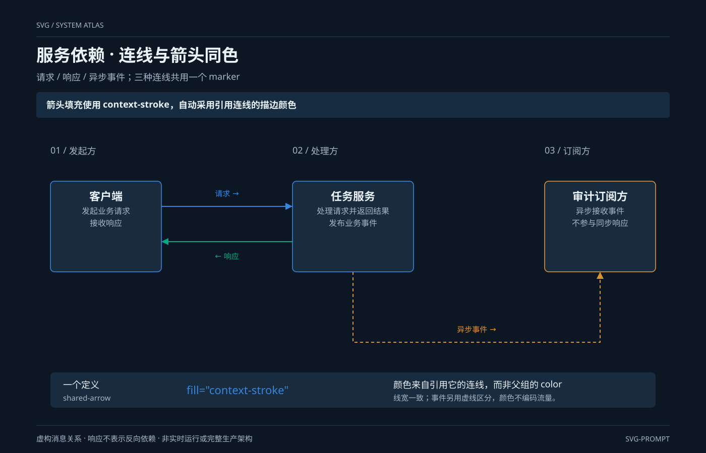

# 服务依赖 · 连线与箭头同色 `静态` `2D`

分类：[流程与架构](../_about.md)



```
用 SVG 制作“服务依赖 · 连线与箭头同色”：请求 / 响应 / 异步事件；三种连线共用一个 marker。
- 画布1400×900，背景#0d1724；标题34px、组件名17–22px、说明15–16px；语义配色：调用蓝、事件橙、数据绿、控制红、关联灰。
- 重点表达：“箭头填充使用 context-stroke，自动采用引用连线的描边颜色”。
- 三条消息关系：客户端→任务服务为蓝色请求#3686d9；任务服务→客户端为绿色响应#00a887；任务服务→审计订阅方为橙色异步事件#d99431。响应只表示返回消息，不是任务服务对客户端的服务依赖。
- 所有连线等宽2px；请求与响应实线，事件虚线6/5。三条marker-end均引用唯一shared-arrow；该marker内三角形fill=context-stroke，不写死颜色、不用currentColor、不复制三个彩色marker。
- shared-arrow参数：viewBox=0 0 10 10、路径M0 0 L10 5 L0 10 Z、refX=10、refY=5、markerWidth=markerHeight=14、markerUnits=userSpaceOnUse、orient=auto；箭头随路径终段朝向旋转，大小不随线宽编码数值。
- 客户端与任务服务分别用y410的右向请求、y480的左向响应，端点在各矩形相对侧边界上；事件从任务服务底边经y680到订阅方底边，箭头朝上。连线不穿过其他节点，标题和标签不压线。
- 这是消息关系示意，不是纯服务依赖DAG，不以线长表达延迟、粗细表达流量或颜色表达实时健康；事件链路省略传输设施，不声称完整生产部署。
- 不引入JS、外部资源或交互。context-stroke的实际渲染需按展示浏览器验证，不能仅靠SVG解析成功判定；标准依据：https://www.w3.org/TR/SVG2/painting.html#context-paint。
- 先列节点坐标与端口；端口l/r/t/b分别为矩形左/右/上/下中点，菱形为对应顶点。按下列坐标绘制：
  - client: 客户端；说明["发起业务请求", "接收响应"]；(x,y,w,h)=(100,360,220,180)；形状box。
  - service: 任务服务；说明["处理请求并返回结果", "发布业务事件"]；(x,y,w,h)=(580,360,240,180)；形状box。
  - subscriber: 审计订阅方；说明["异步接收事件", "不参与同步响应"]；(x,y,w,h)=(1080,360,220,180)；形状box。
- 连线先画、节点后画，线不穿过无关节点。下列方向、条件与折点必须一致：
  - client → service；call；标签“请求 →”；条件“”；折点[[320, 410], [580, 410]]；有箭头。
  - service → client；data；标签“← 响应”；条件“”；折点[[580, 480], [320, 480]]；有箭头。
  - service → subscriber；event；标签“异步事件 →”；条件“”；折点[[700.0, 540], [700, 680], [1190, 680], [1190.0, 540]]；有箭头。
- 页脚注明：“虚构消息关系 · 响应不表示反向依赖 · 非实时运行或完整生产架构”。
```
