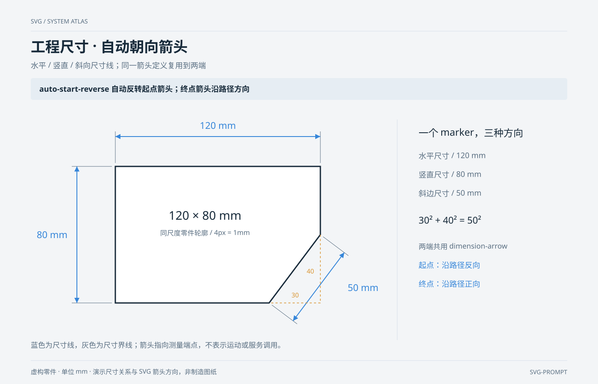

# 工程尺寸 · 自动朝向箭头 `静态` `2D`

分类：[流程与架构](../_about.md)



```
用 SVG 制作“工程尺寸 · 自动朝向箭头”：水平 / 竖直 / 斜向尺寸线；同一箭头定义复用到两端。
- 画布1400×900，背景#f3f5f7；标题34px、组件名17–22px、说明15–16px；语义配色：调用蓝、事件橙、数据绿、控制红、关联灰。
- 重点表达：“auto-start-reverse 自动反转起点箭头；终点箭头沿路径方向”。
- 零件顶点毫米坐标[[0, 0], [120, 0], [120, 40], [90, 80], [0, 80]]；屏幕投影x=270+4u、y=390+4v，单位方向向右/向下。轮廓宽120、高80；右下斜边的水平差30、竖直差40，长度sqrt(30²+40²)=50mm。
- 只定义一个dimension-arrow：viewBox=0 0 10 10、三角形M0 0 L10 5 L0 10 Z、refX=10/refY=5、markerWidth=markerHeight=12、markerUnits=userSpaceOnUse、orient=auto-start-reverse。所有尺寸线的marker-start与marker-end都引用它，不手动旋转箭头。
- 尺寸线按起点/终点绘制：水平(270,320)→(750,320)，竖直(180,390)→(180,710)，斜向(686,752)→(806,592)；对应尺寸120/80/50mm，屏幕长度均等于毫米数×4。
- 尺寸界线从零件对应顶点向尺寸线延伸，距轮廓留8px，超出尺寸线12px；斜向尺寸线为斜边的平行偏移，不用水平投影长度当斜边长度。
- 尺寸文字位置(510,302)/(122,558)/(850,682)，均水平排字以便阅读，不压尺寸线；斜边旁用橙色虚线标出水平30、竖直40的计算辅助线。
- 本图蓝色专用于尺寸线，不沿用其他系统图的调用语义；箭头从跨度中间指向两端测量点，起点反向、终点正向。无脚本与交互。标准依据：https://www.w3.org/TR/SVG2/painting.html#OrientAttribute。
- 页脚注明：“虚构零件 · 单位 mm · 演示尺寸关系与 SVG 箭头方向，非制造图纸”。
```
