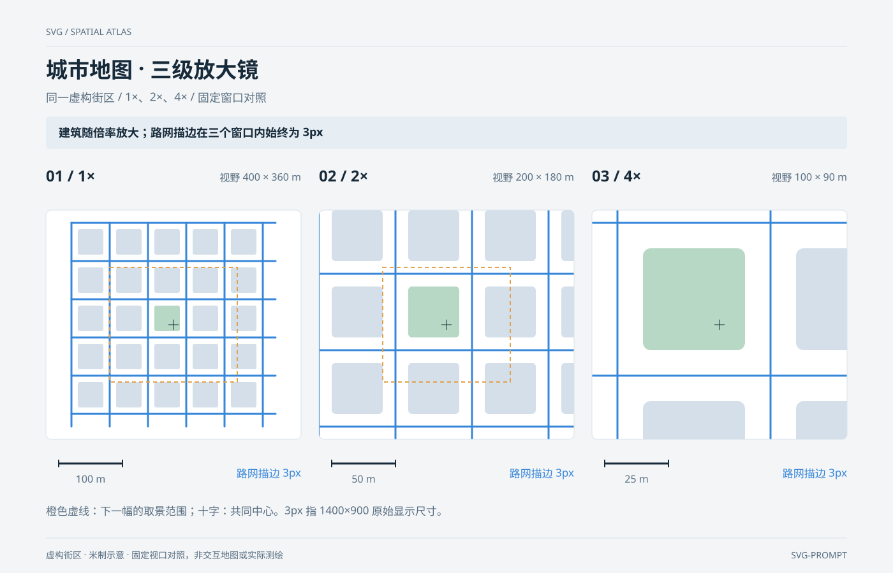

# 城市地图 · 三级放大镜 `静态` `2D`

分类：[地图与空间](../_about.md)



```
用 SVG 制作“城市地图 · 三级放大镜”：同一虚构街区 / 1×、2×、4× / 固定窗口对照。
- 画布1400×900，背景#f3f5f7；标题34px、正文17–18px、刻度14–15px。重点结论：“建筑随倍率放大；路网描边在三个窗口内始终为 3px”。
- 三窗口左上角(72,330)/(500,330)/(928,330)，尺寸400×360px；中心相同为街区(180,180)m，倍率1/2/4，视野400×360、200×180、100×90m。
- 只定义一份street-scene，用use href复用三次；建筑x/y取30..270步长60，40×40m，(150,150)一块为绿地，其余灰蓝。道路横纵坐标20..320步长60，端点范围20..340，共12条。
- 每条道路自身设置stroke-width=3和vector-effect=non-scaling-stroke；建筑填充随组变换放大，道路描边不随地图内部倍率变粗。不能只把属性写在父g或use上，因为vector-effect不继承。
- 各相机变换translate(窗口中心) scale(倍率) translate(-180,-180)，在变换外裁切；1×与2×面板中央橙框200×180px，恰好对应下一幅视野。十字在地图变换外绘制。
- 三个比例尺绘制长度均100px，对应100/50/25m，不能固定距离标签；3px为原画布显示尺寸，整图作为img缩小时描边也随整张图片缩小。
- 不添加JS、外部字体或外部地图资源，三幅同时可读；标准依据：https://www.w3.org/TR/SVG2/coords.html#VectorEffects。
- 页脚明确：“虚构街区 · 米制示意 · 固定视口对照，非交互地图或实际测绘”。
```
