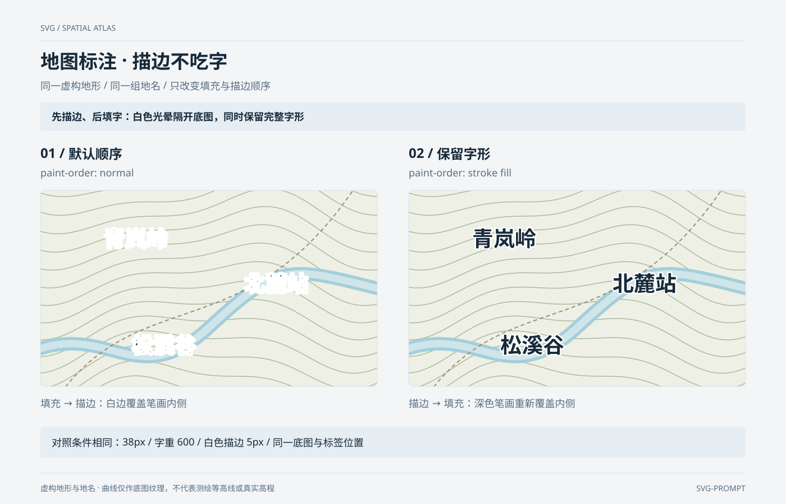

# 地图标注 · 描边不吃字 `静态` `2D`

分类：[地图与空间](../_about.md)



```
用 SVG 制作“地图标注 · 描边不吃字”：同一虚构地形 / 同一组地名 / 只改变填充与描边顺序。
- 画布1400×900，背景#f3f5f7；标题34px、正文17–18px、刻度14–15px。重点结论：“先描边、后填字：白色光晕隔开底图，同时保留完整字形”。
- 左右地图窗口分别位于(72,340)与(728,340)，均600×350px；地形只在defs中定义一次label-terrain，由两个use href实例复用。
- 底色#eef0e5；18条类等高线由x=-20..620、步长5生成，y=-80+30i+32sin(x/90+0.15i)+15cos(x/45)，i=0..17；绿色线宽1.5。曲线是装饰地形纹理，没有真实高程含义。
- 河道路径M-20 290 C120 230 170 365 300 245 S440 135 620 180，外宽24、内宽13；小径M30 370 C180 160 370 290 570 -20，线宽2、虚线7/5；都在地图窗口内裁切。
- 相同地名与局部坐标：[["青岚岭", 170, 100], ["北麓站", 420, 180], ["松溪谷", 220, 290]]；文字38px、字重600、居中、深色#172a3a填充、白色5px描边、round连接；字体使用画布默认系统字体栈。
- 唯一实验变量为文字元素的paint-order：左normal默认先填充再描边，白边压住笔画内侧；右stroke fill先描边再填充，完整深色字形覆盖描边内侧。不能用复制两层文字、改变字重或描边宽度替代此属性。
- 保留左右说明与相同参数条；不添加脚本、交互、外部底图或外部字体。字体差异会改变字形，比较时两侧必须在同一环境渲染。标准依据：https://www.w3.org/TR/SVG2/painting.html#PaintOrder。
- 页脚明确：“虚构地形与地名 · 曲线仅作底图纹理，不代表测绘等高线或真实高程”。
```
