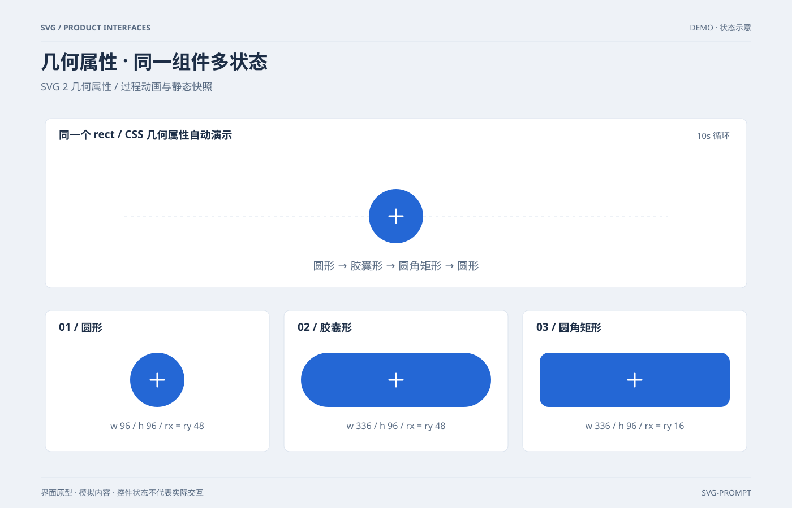

# 几何属性 · 同一组件多状态 `CSS 动效` `2D`

分类：[界面与组件](../_about.md)



```
用 SVG 制作“几何属性 · 同一组件多状态”，用于SVG 2 几何属性。
- 画布1400×900；浅色产品界面，背景#eef2f7、卡片#ffffff、正文#1d2e46、辅助文字#596b82、主色#2467d5；34px标题、15–19px正文、圆角8–12px、8px间距基准。
- 顶部作品标题与分组说明，内容位于x80..1320、y210..820；底部标注界面原型、模拟内容和非真实交互。
- 同一个rect以CSS的x/width/rx/ry属性从圆形扩展为胶囊形，再变为圆角矩形；不靠scale拉伸、不改写path，也不是可点击按钮。
- 主组件中心始终(700,383)、高度96；圆形x652/w96/rx=ry48，胶囊形x532/w336/rx=ry48，圆角矩形x532/w336/rx=ry16；CSS长度显式使用px。
- 10秒循环，ease-in-out：0–15%圆形停留，15–30%扩展，30–45%胶囊停留，45–60%圆角变小，60–75%圆角矩形停留，75–90%回圆形，90–100%停留；起止几何一致，不跳变。
- 所有阶段x+width/2=700，高度与加号不缩放；主组件仅一个带animation的rect，加号是固定的两条白线；虚线标出固定中心轴。
- 下方三张396×250卡片左上角(80,550)/(502,550)/(924,550)，分别显示三种状态的完整静态快照；图形尺寸与主组件一致，参数文字始终对应各自静态快照，不冒充动画实时读数。
- 减少动态效果模式隐藏主动画rect并禁用动画，显示同位置的胶囊形fallback；下方三种状态及全部文字保留。不支持CSS几何属性时，主组件保留SVG属性定义的初始圆形。
- 不添加SMIL、脚本、外部资源或点击交互；使用系统字体。标准依据：https://www.w3.org/TR/SVG2/geometry.html；这是SVG 2几何属性能力示范，不声称该能力是2026年新增。
- 文字与示例值包含：["SVG / PRODUCT INTERFACES", "DEMO · 状态示意", "几何属性 · 同一组件多状态", "SVG 2 几何属性 / 过程动画与静态快照", "界面原型 · 模拟内容 · 控件状态不代表实际交互", "SVG-PROMPT", "同一个 rect / CSS 几何属性自动演示", "10s 循环", "圆形 → 胶囊形 → 圆角矩形 → 圆形", "01 / 圆形", "w 96 / h 96 / rx = ry 48", "02 / 胶囊形", "w 336 / h 96 / rx = ry 48", "03 / 圆角矩形", "w 336 / h 96 / rx = ry 16"]。
- 控件由SVG图形展示状态，不添加真实网络、登录、支付或权限操作；模拟场景不能宣称实时服务。
- CSS几何属性过程演示，不使用SMIL或路径形变；减少动效关闭动画、隐藏motion并显示胶囊形fallback，下方三种静态快照始终可见。
```
